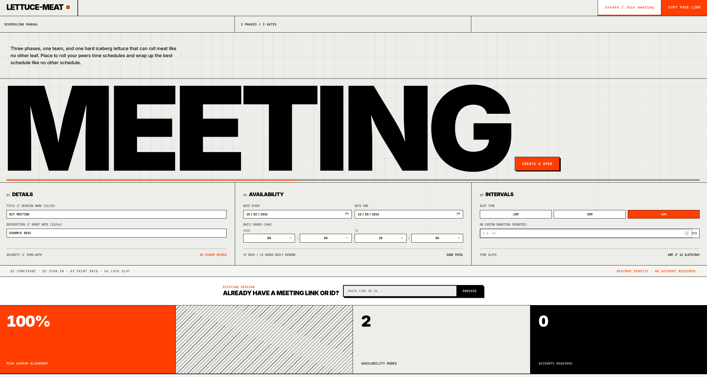
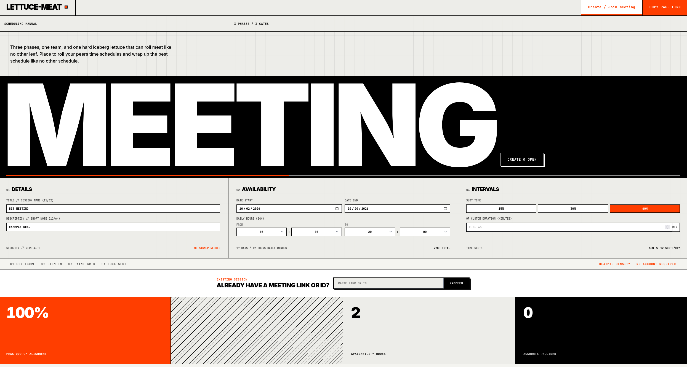
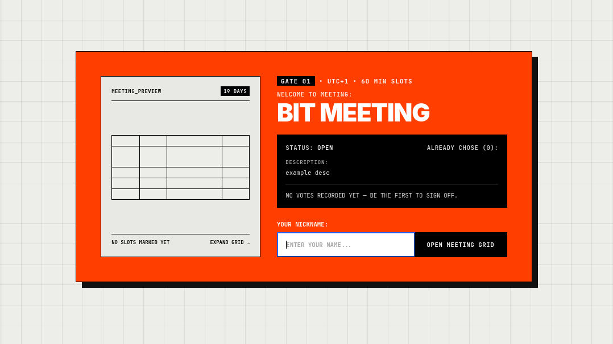
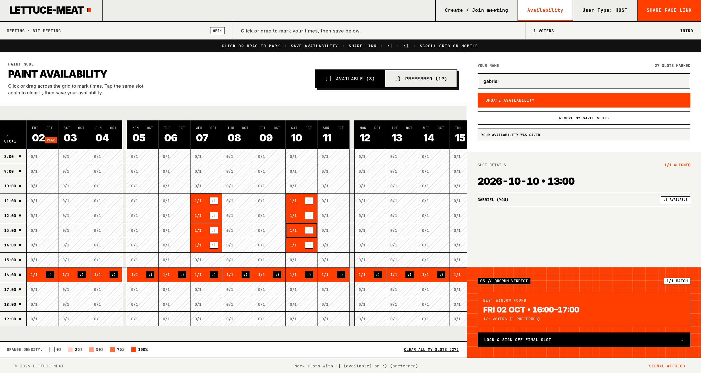

# Lettuce-Meat

Host zakłada spotkanie, reszta maluje siatkę: `:|` = dostępny, `:)` = preferowany. 
---

## Wywiad i plan

Przed kodem siedziałem nad planem w `Back.md` i `Front.md`, żeby potem nie bawić się w ciągłe poprawki i zmianę kierunku.

Rozmawiałem o tym z wieloma osobami, m.in. z **kilku osobami z zarządu innego koła**. Wniosek: **Lettuce-Meet nie jest prosty** — ludzie gubią się przy zaznaczaniu, a dodatkowo irytuje ich logowanie, gdy chcą tylko oddać dostępność. Trzy typowe oczekiwania:

- **Gość:** wchodzi na chwilę — zaznacza, wychodzi, bez konta
- **Admin:** zakłada spotkanie, zamyka głosowanie, widzi wyniki
- **Stały zespół / koło:** co jakiś czas to samo — grupa, zaproszenia, ci sami ludzie na kolejne terminy

**Na oddanie** wysyłam **MVP siatki + API**. To nie jest jeszcze pełna wizja logowania ani grup — tylko rdzeń: spotkanie, siatka, zapis slotów, agregacja.

**Docelowo** (to, co wynika z rozmów, a czego tu jeszcze nie ma):

- **Logowanie** — tylko dla admina, który tworzy spotkanie
- **Laik** — jeden wejście: wybieram dni, zapisuję i koniec; nie muszę wracać na konto
- **Grupy** — dla zalogowanych: zaproszenie do grupy X dostają wszyscy, którzy powinni

**Plan po oddaniu:** obiecany raw SQL i testy benchmarkowe na dużej skali bazy. Przy kilkudziesięciu osobach w kole i małym SQLite różnicy ORM vs raw prawie nie widać — sens ma dopiero duża liczba slotów i uczestników.

---

## Co tu jest (stan na oddanie)

**Backend** (Flask, SQLAlchemy, SQLite):

- tworzenie spotkania, odczyt z agregacją slotów
- zapis dostępności, token edycji w nagłówku `X-Edit-Token`
- walidacja Pydantic
- testy: `backend/tests/test_meetings.py`
- benchmarki ORM: `test_benchmark.py`, wykresy w `benchmark_plots.ipynb`

**Frontend** (React, Vite, Tailwind z CDN):

- formularz spotkania, siatka (malowanie, drag/touch, szybkie zaznaczenie całego dnia lub godziny)
- token w `localStorage` (`lettucemeat_token_<meetingId>`)
- wygląd według `DESIGN.md` — neo-brutalism, pomarańcz `#FF3E00`

Strona **nie jest prosta** — lubię neo-brutalism i nie chciałem robić czegoś „ładnego i pustego”. Wolę panel niż kolejny miły kalendarz; jest welcome gate i legenda przy siatce, żeby łatwiej się odnaleźć.

---

## Czego nie ma

| Obszar | Docelowo (z rozmów) | W tej wersji |
|--------|---------------------|--------------|
| Logowanie | admin ma konto przy tworzeniu; gość jednorazowo, bez konta | nick + token gościa, bez rejestracji |
| Grupy | grupa, zaproszenia, ci sami ludzie na kolejne spotkania | brak |
| Zamknięcie | admin wybiera slot, koniec głosowania | pole `status` w modelu, bez UI |
| Live | po zapisie innych widać zmiany bez odświeżania | ręczne odświeżenie strony |
| Skala | Postgres, Docker | SQLite lokalnie |
| Miejsce spotkania | wybór lokalizacji | brak |

---

## Uruchomienie

**Backend:**

```bash
cd backend
python -m venv .venv
source .venv/bin/activate
pip install -r requirements.txt
export FLASK_APP=app.py
flask run
```

API: `http://127.0.0.1:5000`

**Frontend:**

```bash
cd frontend/client
npm install
npm run dev
```

Zapytania `/api` idą przez proxy Vite do backendu.

**Testy:**

```bash
cd backend
PYTHONPATH=. pytest tests/test_meetings.py -q
PYTHONPATH=. pytest tests/test_benchmark.py --benchmark-only --benchmark-autosave
```

Wykresy: uruchom `benchmark_plots.ipynb` z katalogu głównego repo.

Stack: Python / Flask / SQLAlchemy / SQLite / Pydantic oraz React / Vite / TypeScript; szczegóły w `Back.md` i `DESIGN.md`.

---

## AI / narzędzia

Korzystałem z asystentów AI przy planowaniu, burzy mózgów, fragmentach frontendu i backendu oraz przy tym readme.

Starałem się każdy wygenerowany kod zrozumieć i powoli uczyć się, zamiast tylko promptować i oglądać yt — dlatego część pomysłów z planu nie zdążyła wejść do kodu przed terminem.

---

## Zrzuty ekranu

| Ekran | Opis |
|-------|------|
|  | strona główna — od razu tworzenie spotkania |
|  | strona spotkania przed wejściem na siatkę (proceed) |
|  | krótki opis przed malowaniem slotów |
|  | zaznaczona dostępność i sidebar z informacjami |
